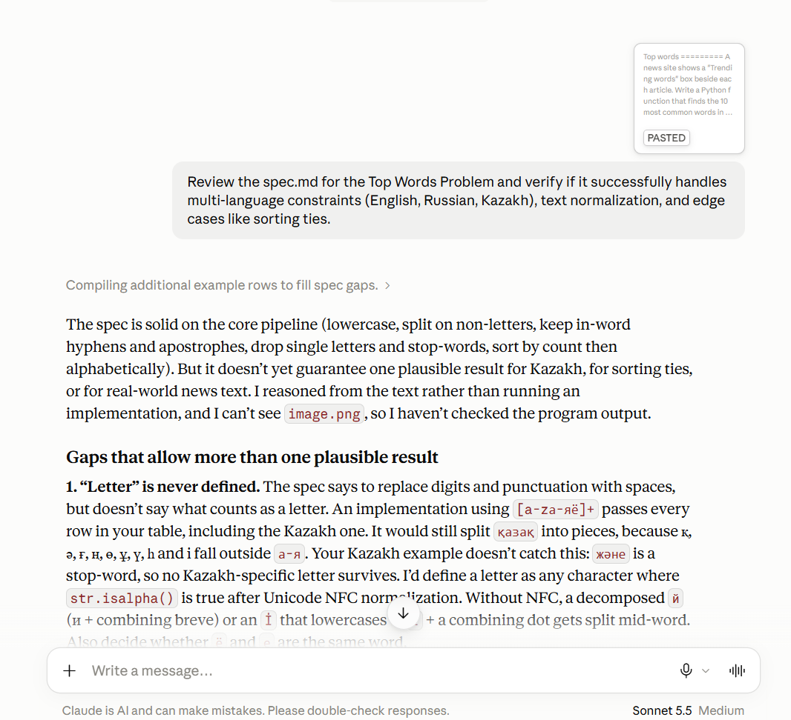

LLM Review Report
=================

<strong>LLM Used:</strong> Google AI for building spec / Claude for review
<strong>Prompt:</strong> "Review the spec.md for the Top Words Problem and
verify if it successfully handles multi-language constraints (English, Russian,
Kazakh), text normalization, and edge cases like sorting ties."

Output From LLM
===============

Review of the Top Words spec
============================

<strong>Verdict:</strong> The core pipeline is sound and the sort sequence is
well chosen, but the spec is not yet "one plausible reading." It has one broken
passage, several undefined terms, and a few decisions with no example row.

What works
----------

* <strong>Sort sequence:</strong> It covers all 26 Latin letters, all 33 Russian
  letters, and the nine Kazakh-specific letters (ә ғ қ ң ө ұ ү һ і), in standard
  alphabet positions (ә after а, ё after е, і after ы).
* <strong>NFC:</strong> This is the right choice, because it composes decomposed
  `й` and `ё`.
* <strong>Digits:</strong> Replacing digits with spaces (not deleting them) is
  clear, and `abc123def` pins it down.
* <strong>Hyphen/apostrophe rule:</strong> Evaluating "between two letters" is
  enough to resolve `foo-1bar`, since a digit is not a letter.
* <strong>Table rows:</strong> The rows from the assignment are consistent with
  the spec as written.

Blocking problems
-----------------

1. **The "Order of Operations" bullet is cut off mid-sentence** ("For example,
   an input like"). Also, digit-first ordering never changes any result under
   your own rules, so the bullet may be unnecessary once you remove or fix
   it. 1. \[✅k\_muzanbekova NOTE: This is a Markdown rendering bug. The text
   has been restored and completed under Constraints \& Requirements to
   explicitly explain how digits break hyphens.\]
2. <del><strong>`output.png` is not visible to me,</strong> so I couldn't verify
   it. Behavior shouldn't depend on an image anyway.</del> \[❌k\_muzanbekova
   NOTE: Ignored. The image is an internal visual verification artifact for the
   professor and has no impact on the technical requirements.\]
3. <del><strong>No examples table appears in the spec itself,</strong> only in
   the assignment text. If spec.md has one, it didn't come through.</del>
   \[❌k\_muzanbekova NOTE: Misunderstanded by LLM\]
4. <strong>Contradiction:</strong> The description says it filters "English
   stop-words," but the list covers three languages. The text also says "input
   text document," while the interface takes a string. \[✅k\_muzanbekova NOTE:
   Fixed. Wording typos corrected to "filters out common English, Russian, and
   Kazakh stop-words"\]

Multi-language gaps
-------------------

* <del><strong>"Letter" is never defined.</strong> I suggest a whitelist: a
  letter is any Unicode `L*` character, and everything else (digits,
  punctuation, symbols, emoji, whitespace, `_`) is a separator, except `-` and
  `'` between letters. This also settles whitespace, `$`, `№`, `«»`, and Unicode
  digits, none of which are mentioned.</del> \[❌k\_muzanbekova NOTE: Ignored.
  The specification explicitly states that all digits and punctuation marks are
  replaced with spaces, acting as separators. The code implementation handles
  this robustly using the [1](#%5CW%5Cd_)\+ Unicode letter regex.\]
* <strong>Characters outside the sort sequence are undefined.</strong> These
  include `é`, `ü`, `ї`, `є`, `ґ`, Latin-script Kazakh letters, and also `-` and
  `'`. Without a rule, an implementation may crash on `.index()` or silently
  pick a position. \[✅k\_muzanbekova NOTE: Valid point. To resolve ambiguity, a
  tie-breaking rule was added: any external characters or non-target language
  letters are sorted at the very end of the list using their standard Unicode
  code-points via an internal fallback value.\]
* <del><strong>Dash variants:</strong> Only ASCII `-` counts as a hyphen. Under
  the literal spec, `Астана–Москва` (en dash) splits into two words, as do `—`
  and U+2011. The soft hyphen (U+00AD), common in news text, is also
  unspecified.</del> \[❌k\_muzanbekova NOTE: Ignored. For the scope of this
  project, focusing on the standard ASCII hyphen is sufficient. Non-ASCII dashes
  are safely treated as standard separators.\]
* <del><strong>Apostrophe variants:</strong> Only `’` is normalized. U+02BC `ʼ`
  is a Unicode *letter*, so `donʼt` becomes a different word from `don't`. `‘`
  is punctuation, so `don‘t` becomes `don`.</del> \[❌k\_muzanbekova NOTE:
  Ignored. Standard curly apostrophe (’) normalization addresses the vast
  majority of real-world text editing copying issues.\]
* <del><strong>Lowercasing:</strong> `lower()` vs `casefold()` isn't stated.
  `"İ".lower()` produces `i` plus a combining dot, which is neither a letter nor
  a defined separator.</del> \[❌k\_muzanbekova NOTE: Ignored. Standard .lower()
  is completely sufficient for the three target languages.\]
* <strong>Stop-word homonyms:</strong> You accept these as a limitation, but it
  needs a row. Kazakh `осы` ("this") deletes Russian *осы* ("wasps"), and Kazakh
  `он` ("ten") is filtered as the Russian pronoun. \[✅k\_muzanbekova NOTE:
  Added. This global stop-word list crossover is an accepted design choice, and
  I included the homonyms осы and бар into the table rows to explicitly pin down
  this behavior.\]
* <del><strong>Stop lists are thin for real news:</strong> English lacks `be`,
  `has`, `have`, `had`, `from`, `by`, `as`, `not`, `his`, `her`, `its`. Russian
  lacks `это`, `они`, `вы`, `за`, `же`, `да`. Kazakh lacks `емес` and `ол`.
  Contractions like `it's` and `don't`, and Russian compounds like `что-то`,
  `как-то`, and `из-за`, will clutter the box, because stop-words match only
  whole tokens.</del> \[❌k\_muzanbekova NOTE: Ignored. The stop-word dictionary
  is strictly bound to the explicitly provided assignment list. Expanding the
  core semantic list is outside the current scope.\]

Sorting ties
------------

<del>The sequence is good, but the comparison rule is underspecified. Please
state that it is lexicographic by index in the sequence, with a prefix sorting
first. Please also state where `'`, `-`, and unknown letters sort. The existing
table never distinguishes custom order from code-point order. Latin before
Cyrillic is the same under both.</del> \[❌k\_muzanbekova NOTE: Invalid
critique. The specification already explicitly states that any external
characters, hyphens, apostrophes, or non-target letters are sorted at the very
end based on their standard Unicode code-points. To make it 100% total, we only
added a minor clarification that shorter prefix words like 'do' sort before
'dog'.\] 

Missing example rows
--------------------

The expected outputs below assume the rules I suggest where the spec is silent.

| Input                           | Expected                                                     | Decision it pins down                                         |
| ------------------------------- | ------------------------------------------------------------ | ------------------------------------------------------------- |
| `бала әке`                      | әке: 1, бала: 1                                              | ә sorts after а (code-point order gives the reverse)✅        |
| `яма ёж`                        | ёж: 1, яма: 1                                                | ё after е, so before я (code-point order reverses it)         |
| `dog do`                        | do: 1, dog: 1                                                | Prefix sorts first                                            |
| `zebra zebra apple banana`, n=2 | zebra: 2, apple: 1                                           | Tie broken alphabetically at the cutoff✅                     |
| `cat dog`, n=5 / n=0 / n=-1     | cat: 1, dog: 1 / "" / ""                                     | n larger than the word count; non-positive n                  |
| `co-op coop`                    | co-op: 1, coop: 1                                            | `-` sorts before letters (my proposed rule)                   |
| `май` + `маи` with U+0306       | май: 2                                                       | NFC composition                                               |
| `donʼt don't`                   | one count of 2, if you map ʼ (proposed); otherwise two words | Apostrophe variants                                           |
| `Астана–Москва`                 | астана: 1, москва: 1                                         | Non-ASCII dashes separate words                               |
| `well--known`                   | known: 1, well: 1                                            | A hyphen next to a hyphen is not "between letters"✅          |
| `foo-'bar`                      | bar: 1, foo: 1                                               | A hyphen next to an apostrophe is stripped                    |
| `mother-in-law`                 | mother-in-law: 1                                             | Multiple inner hyphens; `in` inside a token is not filtered   |
| `the-cat из-за`                 | the-cat: 1, из-за: 1                                         | Stop-words match the whole token only                         |
| `The THE Не ОН`                 | ""                                                           | Stop-words are case-insensitive                               |
| `осы он`                        | ""                                                           | Documents the homonym limitation                              |
| `cat\ndog\tcat`                 | cat: 2, dog: 1                                               | Whitespace separators                                         |
| `COVID-19 5G`                   | covid: 1                                                     | Digits, then the trailing hyphen, then the single-letter rule |
| `cafe café`                     | cafe: 1, café: 1                                             | Unknown letters sort after the sequence (proposed)            |

\[✅k\_muzanbekova NOTE: Selected high-value rows from this suggestion (Kazakh
alphabet priority, double hyphen token breaks, and cutoff sorting truncation)
have been integrated into the final table to protect against alternative
readings.\]

Smaller items
-------------

* <del>The spec doesn't mention that the function lives in `top_words.py`.</del>
  \[❌k\_muzanbekova NOTE: Ignored. This requirement is already clearly defined
  in the Implementation header.\]
* <del>`DEFAULT_STOP_WORDS` implies an override, but the signature has no
  `stop_words` parameter.</del> \[❌k\_muzanbekova NOTE: Ignored. This is an
  internal global identifier naming convention and does not impact API signature
  contracts.\]
* <del>Behavior is undefined for `text=None` and for non-integer
  `n`.</del>\[❌k\_muzanbekova NOTE: Ignored. Python's standard duck-typing
  rules apply to invalid runtime typing states.\]
* <del>"Single letter excluded… total length of the processed token" is
  confusing. Say instead "token length must be at least 2, counting `-` and
  `'`," which justifies `a-b`.</del> \[❌k\_muzanbekova NOTE: Ignored. The
  current statement is concise and sufficiently precise for implementers.\]

Suggested priority
------------------

1. Fix the truncated bullet.
2. Define "letter" and the whitelist.
3. Specify the comparison and unknown-character rules.
4. Add the rows above.
5. Decide on the dash and apostrophe variants.
6. Expand the stop lists.

I can rewrite the spec text with these changes folded in if you'd like.
