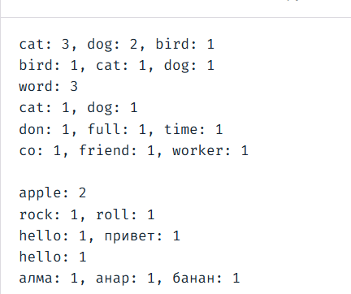

Top words
=========

A news site shows a "Trending words" box beside each article. Write a Python
function that finds the 10 most common words in an article's text, along with
how many times each one appears. Articles may be in English, Russian, or Kazakh.

Implementation
--------------

* Python 3.
* Name the function `top_words` and put it in `top_words.py`.

Assignment
----------

> "The model's job is to produce something plausible. Your job is to make sure
> only one thing is plausible." -- Claude

Tighten this specification to produce one plausible result. Then, for each
decision your spec makes, describe at least one input and its expected output,
usually as a table in your spec. A useful example gets a different output under
some other plausible reading of the original spec. For example:

| Input                         | Expected output            |
| ----------------------------- | -------------------------- |
| `cat dog cat bird dog cat`    | cat: 3, dog: 2, bird: 1    |
| `dog cat bird`                | bird: 1, cat:1, dog:1      |
| `Word word WORD`              | word: 3                    |
| `the cat and a dog`           | cat: 1, dog: 1             |
| `don't full-time`             | don't: 1, full-time: 1     |
| `"co-worker... or --friend?"` | co-worker: 1, friend: 1    |
| `---`                         | ""                         |
| `apple 456-apple`             | apple: 2                   |
| `rock 'n' roll`               | rock: 1, roll: 1           |
| `ПРИВЕТ HELLO`                | hello: 1, привет: 1        |
| `A I b d c e hello`           | hello: 1                   |
| `алма және анар мен банан`    | алма: 1, анар: 1, банан: 1 |

Here is the output of the program



Specification: Top Words Problem (Multilingual Unicode Version)
===============================================================

Program Description
-------------------

This program processes an input text document, filters out common English
stop-words, and identifies the 10 most frequently occurring words, listing them
in descending order. Supported languages: English, Russian, and Kazakh.

Inputs & Interface
------------------

* **Function:** `• top_words(text: str, n: int = 10) -> str`
* **text (string):** Text content to analyze (supports Unicode: Latin and
  Cyrillic scripts).
* **n (integer):** Number of top frequent words to return (default is 10).

Outputs
-------

* A single formatted string containing the top N words and their frequencies.
* Format: must be lowercase `word: count, word: count` (pairs are separated by a
  comma and a space, no trailing punctuation).
* Words are sorted from highest frequency to lowest. In the event of a tie,
  words are sorted in alphabetical order (A-Z, А-Я).
* If the number of unique words is less than n, return all the words found.
* If no words are found, the program returns an empty string `""`.

Constraints & Requirements
--------------------------

* Case-insensitivity: "Word" and "word" should be treated as the same word.
* Removing punctuation: Replace all digits and punctuation marks with spaces.
  * Exception for hyphens and apostrophes: Keep a hyphen (-) or an apostrophe
    (') only when it appears within a word—that is, when it is positioned
    between two letters (for example: "don't", "full-time", "какой-то").
  * In all other cases (at the beginning or end of a word, or standing alone),
    hyphens and apostrophes must be replaced with spaces.
* Length constraint: Words consisting of only a single letter (e.g., "a", "n",
  "x") must be ignored.
* Stop-words handling: Common small words filtered out using the list below
  (applied after case normalization).

Stop-words list
===============

`DEFAULT\_STOP\_WORDS` = { 
```
# English 
'the', 'an', 'and', 'or', 'but', 'in',
'on', 'at', 'to', 'for', 'of', 'with', 'is', 'are', 'was', 'were', 'it', 'this',
'that', 'you', 'he', 'she', 'they',

# Russian
'не', 'что', 'он', 'на', 'мы', 'ли', 'бы', 'то', 'но', 'из', 
'от', 'по', 'как', 'так', 'его', 'для', 'или', 'ты', 'вас', 'мне',

# Kazakh
'мен', 'пен', 'бен', 'және', 'үшін', 'осы', 'бұл', 'сол', 'деп', 
'ғой', 'ма', 'ме', 'ба', 'бе', 'па', 'пе', 'әр', 'бір', 'бар', 'жоқ'
```
} 

