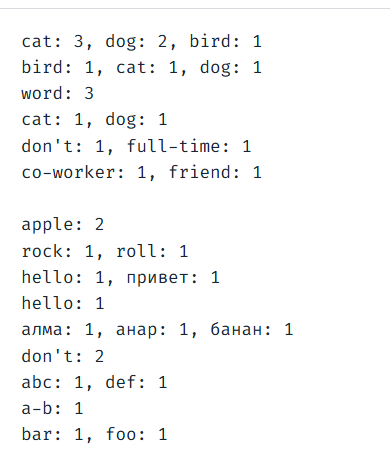

Top words
=========

A news site shows a "Trending words" box beside each article. Write a Python
function that finds the 10 most common words in an article's text, along with
how many times each one appears. Articles may be in English, Russian, or Kazakh.

Implementation
--------------

* Python 3.
* Name the function `top_words` and put it in `top_words.py`.

Assignment
----------

> "The model's job is to produce something plausible. Your job is to make sure
> only one thing is plausible." -- Claude

Tighten this specification to produce one plausible result. Then, for each
decision your spec makes, describe at least one input and its expected output,
usually as a table in your spec. A useful example gets a different output under
some other plausible reading of the original spec. For example:

| Input                         | Expected output            |
| ----------------------------- | -------------------------- |
| `cat dog cat bird dog cat`    | cat: 3, dog: 2, bird: 1    |
| `dog cat bird`                | bird: 1, cat:1, dog:1      |
| `Word word WORD`              | word: 3                    |
| `the cat and a dog`           | cat: 1, dog: 1             |
| `don't full-time`             | don't: 1, full-time: 1     |
| `"co-worker... or --friend?"` | co-worker: 1, friend: 1    |
| `---`                         | ""                         |
| `apple 456-apple`             | apple: 2                   |
| `rock 'n' roll`               | rock: 1, roll: 1           |
| `ПРИВЕТ HELLO`                | hello: 1, привет: 1        |
| `A I b d c e hello`           | hello: 1                   |
| `алма және анар мен банан`    | алма: 1, анар: 1, банан: 1 |
| `don't don’t`                 | don't: 2                   |
| `abc123def`                   | abc: 1, def: 1             |
| `a-b`                         | a-b: 1                     |
| `foo-1bar`                    | bar: 1, foo: 1             |
| `осы прилетели`               | прилетели: 1               |
| `бала әке`                    | әке: 1, бала: 1            |
| `well--known`                 | known: 1, well: 1          |
| `dog cat bird` with n=2	      | bird: 1, cat: 1            |

Here is the output of the program 

Specification: Top Words
========================

Program Description
-------------------

This program processes an input text document, filters out common English, Russian, and Kazakh stop-words, and identifies the 10 most frequently occurring words, listing them in descending order. Supported languages: English, Russian, and Kazakh.

Inputs \& Interface
-------------------

* <strong>Function:</strong> `top_words(text: str, n: int = 10) -> str`
* <strong>text (string):</strong> Text content to analyze.
  * The text is normalized using Unicode NFC format.
  * All curly apostrophes (`’`) are standardized into straight apostrophes
    (`'`).
  * Text processing is case-insensitive.
  * All digits and punctuation marks are replaced with spaces, acting as word
    separators.
  * Keep a hyphen (`-`) or an apostrophe (`'`) only when it appears within a
    word—that is, when it is positioned between two letters (for example:
    "don't", "full-time", "какой-то"). In all other cases (at the beginning or
    end of a word, or standing alone), hyphens and apostrophes must be replaced
    with spaces.
* <strong>n (integer):</strong> Number of top frequent words to return (default
  is 10).

Outputs
-------

* A single formatted string containing the top N words and their frequencies.
* Format: must be lowercase `word: count, word: count` (pairs are separated by a
  comma and a space, The output string must contain **no leading or trailing
  whitespaces**).
* Words are sorted from highest frequency to lowest. In the event of a tie,
  words must be sorted alphabetically using the following **custom character
  sequence**
  * `abcdefghijklmnopqrstuvwxyzаәбвгғдеёжзийкқлмнңоөпрстуұүфхһцчшщъыіьэюя`
  * Sorting is strictly lexicographic, meaning shorter prefix words (e.g., `do`) must sort before extended words (e.g., `dog`).
  * Any external characters, hyphens, apostrophes, or non-target language letters not listed in this sequence are sorted at the very end based on their standard Unicode code-points
* If the number of unique words is less than `n`, return all the found words.

Constraints \& Requirements
---------------------------

* <strong>Invalid Inputs:</strong> If `text` is empty, contains no valid words,
  or `n <= 0`, the function immediately returns an empty string `""`.
* <strong>Length constraint:</strong> Words consisting of only a single letter
  are excluded. This rule applies to the total length of the processed token.
* <strong>Order of Operations:</strong> Digits and standalone punctuation are
  stripped or converted to spaces first.

Stop-words list
===============

`DEFAULT_STOP_WORDS` = {

```
# English 
'the', 'an', 'and', 'or', 'but', 'in', 'on','at',
'to', 'for', 'of', 'with', 'is', 'are', 'was', 'were', 
'it', 'this', 'that', 'you', 'he', 'she', 'they',

# Russian
'не', 'что', 'он', 'она', 'на', 'мы', 'ли', 'бы', 'то', 'но', 'из', 
'от', 'по', 'как', 'так', 'его', 'для', 'или', 'ты', 'вас', 'мне',

# Kazakh
'мен', 'пен', 'бен', 'және', 'үшін', 'осы', 'бұл', 'сол', 'деп', 
'ғой', 'ма', 'ме', 'ба', 'бе', 'па', 'пе', 'әр', 'бір', 'жоқ', 'бар'
```

}

<em>Note on Stop-Words:</em> The stop-word list is global across all supported
languages. Inter-language homonyms are accepted as a design limitation and will
be filtered out regardless of the text language.
